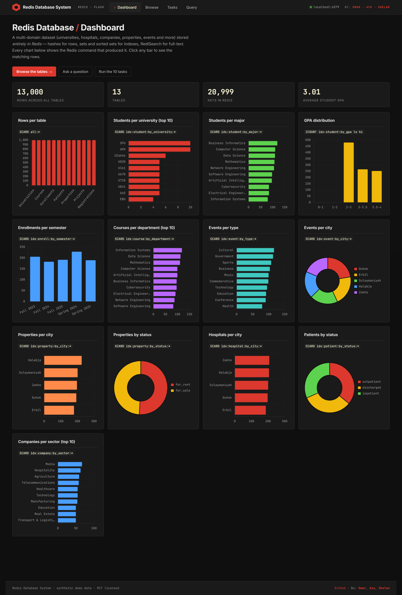
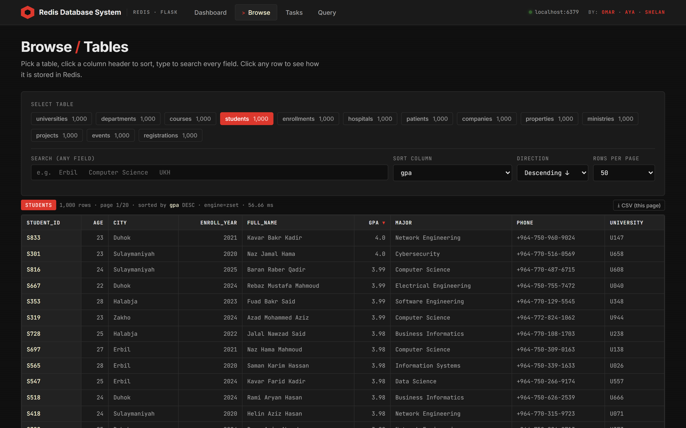
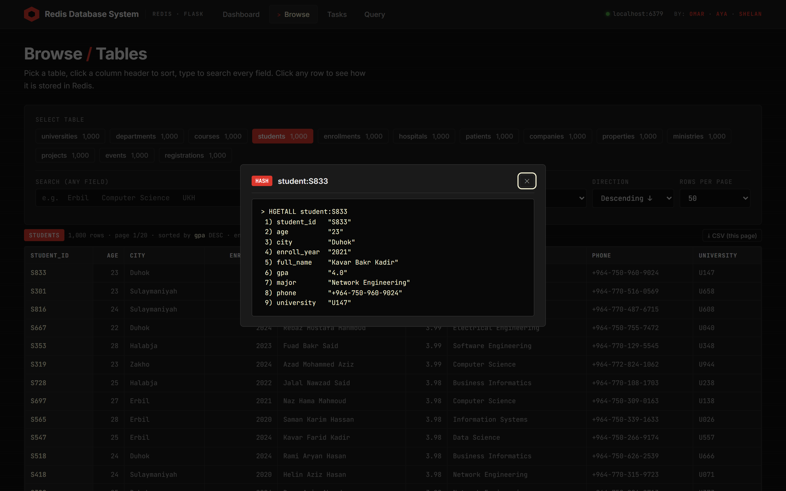
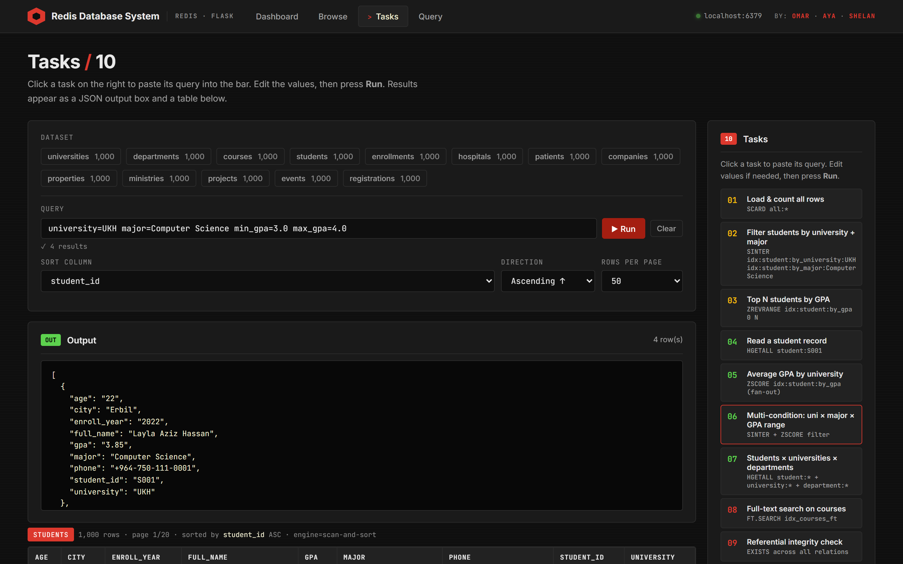
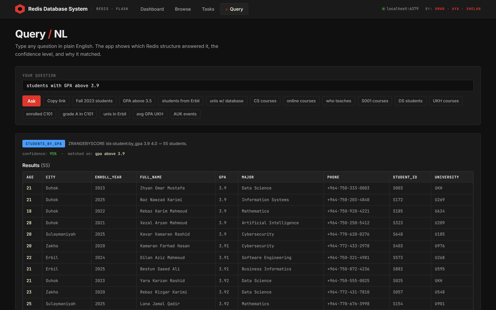
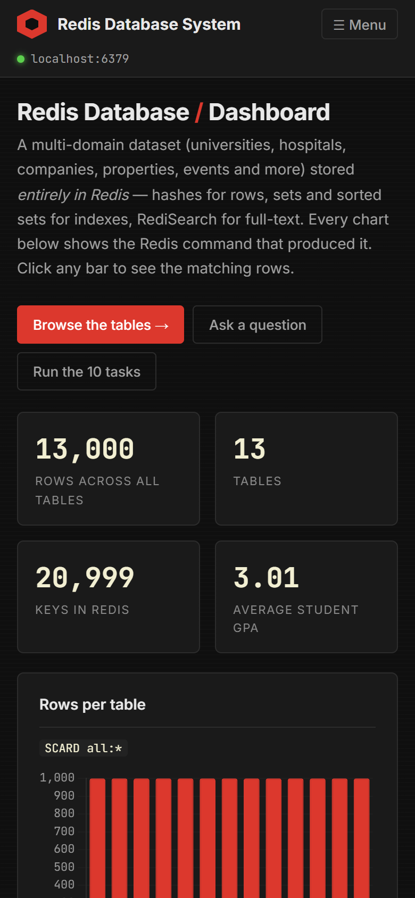

# Redis Database System

[](https://github.com/OWNER/REPO/actions/workflows/ci.yml)
[](LICENSE)

**Redis used as a primary database, not a cache.** 13 tables / 13,000 rows across
education, healthcare, business, real estate, government and events are loaded into
Redis and explored through a Flask web UI that shows *the Redis command behind every answer*.



<!-- **Live demo:** https://your-site.example -->

**By Omar · Aya · Shelan** · MIT licensed — free to use, fork and learn from.
All data is synthetic.

---

## Features

| Page | What it does |
|---|---|
| **Dashboard** (`/`) | Headline stats and 13 live charts. Each shows its Redis command; click a bar to jump to the matching rows. |
| **Browse** (`/browse`) | All 13 tables with search, sort and pagination. Click a row to see it as `HGETALL`. Shareable URLs, CSV export. |
| **Tasks** (`/tasks`) | Ten query tasks from basic filters to RediSearch and referential-integrity checks, with raw JSON output. |
| **Query** (`/ask`) | Plain-English questions answered by deterministic pattern matching over Redis structures (no LLM). Shows the intent, confidence and timing. |

Also: health check (`/healthz`), read-only mode for public hosting, rate-limit-friendly
input validation, responsive layout, and 15 automated tests.

## Screenshots

| Browse any of the 13 tables | Click a row to see the raw Redis hash |
|---|---|
|  |  |

| Ten query tasks | Natural-language questions |
|---|---|
|  |  |



Screenshots are generated with `python scripts/take_screenshots.py`
(uses fakeredis, so timings shown on the live app will differ).

## Quick start (Docker, one command)

```bash
git clone https://github.com/OWNER/REPO.git
cd REPO
docker compose up --build
```

Open **http://localhost:5000**. The app loads the CSVs into Redis on first boot.
RedisInsight is at http://localhost:8001.

## Run without Docker for the app

Prerequisites: Python 3.10+, and a Redis Stack server (RediSearch is needed for full-text search;
everything else works on plain Redis).

```bash
docker compose up -d redis            # Redis Stack only
python -m pip install -r requirements.txt
python scripts/load_redis.py --reset  # load the 13 CSVs
python app/app.py                     # http://127.0.0.1:5000
```

CLI alternative: `python scripts/run.py` (all tasks), `python scripts/run.py 8`, or
`python scripts/run.py ask "what courses does UKH offer?"`.

## Configuration

Environment variables (see [.env.example](.env.example)):

| Variable | Default | Purpose |
|---|---|---|
| `REDIS_HOST` / `REDIS_PORT` / `REDIS_PASSWORD` | `localhost` / `6379` / – | Redis connection |
| `READ_ONLY` | `0` | `1` blocks create/update/delete — **use this for public demos** |
| `AUTO_LOAD` | `0` (`1` in compose) | Load `./data` when the database is empty |
| `FLASK_DEBUG` | `0` | Debugger; local development only |
| `HOST` / `PORT` | `127.0.0.1` / `5000` | Dev-server bind address |
| `DASHBOARD_CACHE_SECONDS` | `30` | Dashboard aggregation cache |
| `REPO_URL` | – | GitHub link in the footer |

### Hosting it publicly

```bash
READ_ONLY=1 docker compose up -d --build
```

Redis ports are bound to `127.0.0.1` in the compose file, so only the web app is exposed.
Put it behind a reverse proxy with TLS (Caddy/nginx) and consider rate limiting. If you
expose Redis itself, set a password.

## How the data is modelled

Each row is a Redis **HASH** (`student:S001`). Categorical lookups are **SETs**
(`idx:student:by_university:UKH`) so "students at UKH majoring in CS" is one `SINTER`.
Numeric ranges (GPA, price, beds, budget) live in **SORTED SETs** for `O(log n + k)`
range queries. Many-to-many relations (enrollments, registrations) are materialised on both
sides. RediSearch indexes over courses, students and events power free-text search.
Full design and trade-offs: **[docs/SCHEMA.md](docs/SCHEMA.md)**.

## The ten tasks

| # | Tier | Task | Redis features |
|---|---|---|---|
| 1 | Basic | Load + row counts | `SCARD` |
| 2 | Basic | Students by university + major | `SINTER` |
| 3 | Basic | Top-N students by GPA | `ZREVRANGE`, `ZSCORE` |
| 4 | Intermediate | Student CRUD with index maintenance | `HSET` / `HGETALL` / `DEL`, `SADD`/`SREM` |
| 5 | Intermediate | Average GPA by university | set + sorted-set fan-out |
| 6 | Intermediate | University × major × GPA range | `SINTER` + `ZSCORE` |
| 7 | Intermediate | Students × universities × departments join | hash lookups |
| 8 | Advanced | Full-text search over courses | `FT.CREATE`, `FT.SEARCH` |
| 9 | Advanced | Referential-integrity validation | membership checks |
| 10 | Advanced | Composite dashboard query | everything above in one call |

## Project layout

```
app/app.py       Flask app and JSON API
app/queries/     query logic: core, tasks, nlq, browse, dashboard
scripts/        load_redis.py, run.py (CLI), generate_data.py, take_screenshots.py
templates/      Jinja pages: dashboard, browse, tasks, ask, error
static/         app.js (shared helpers) and vendored Chart.js
data/           the 13 CSVs
tests/          pytest suite (fakeredis, no Redis server needed)
docs/SCHEMA.md  schema design and justification
docs/img/       screenshots
```

## Development

```bash
pip install -r requirements-dev.txt
pytest -q
ruff check app scripts tests
```

Tests run against `fakeredis`, so no Redis server is required (RediSearch paths fall back
to a scan-based search).

## Troubleshooting

- **"Cannot reach Redis"** — start it with `docker compose up -d redis` and check `/healthz`.
- **Empty tables** — run `python scripts/load_redis.py --reset`, or start with `AUTO_LOAD=1`.
- **`No module named 'redis.commands.search.index_definition'`** — `pip install --upgrade redis`.
- **Port 6379 or 5000 already in use** — change the port mappings in `docker-compose.yml`.

## License

[MIT](LICENSE) © Omar, Aya, Shelan
